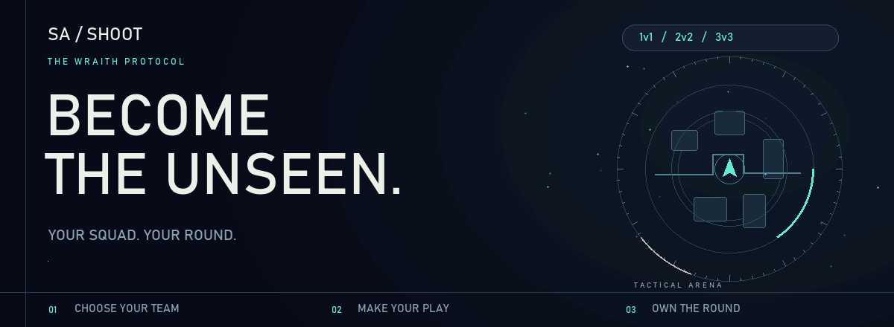
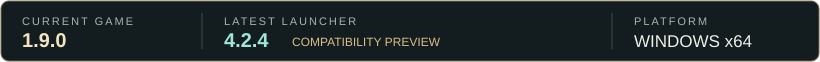
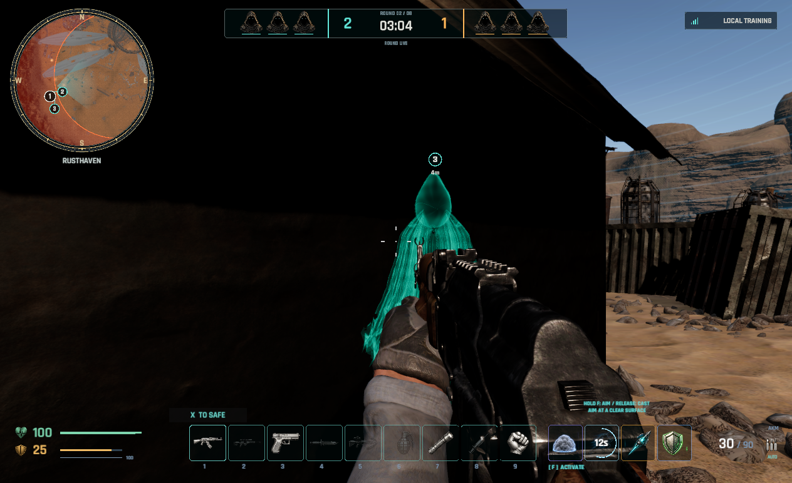
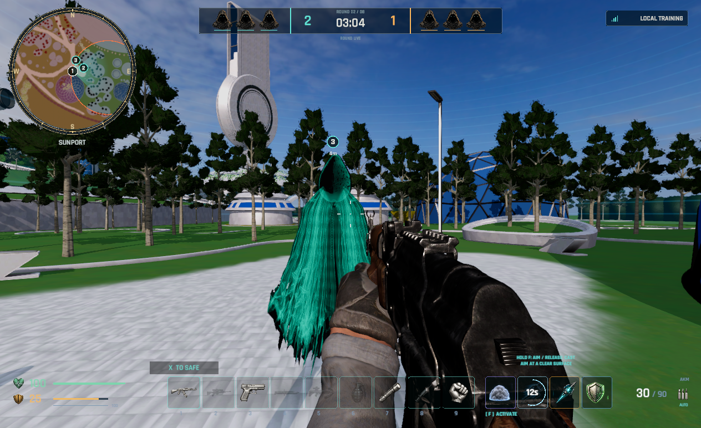
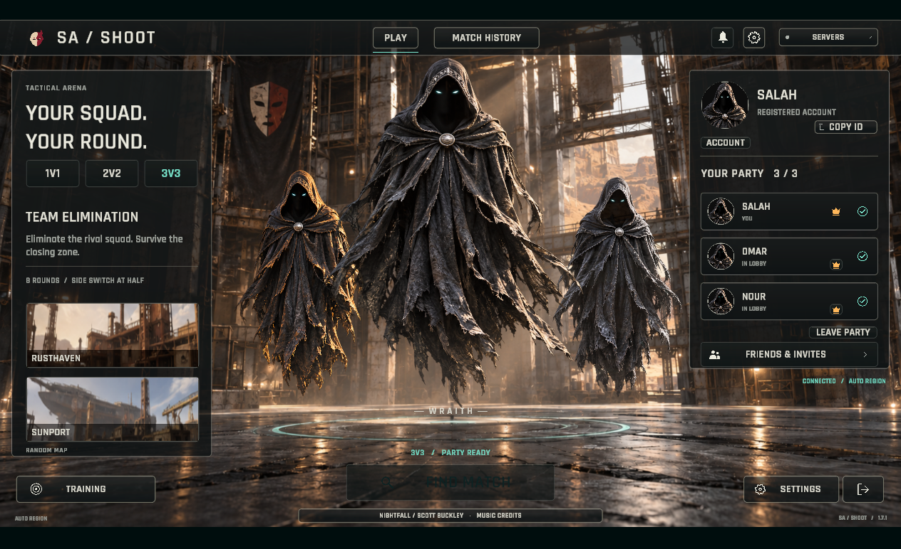
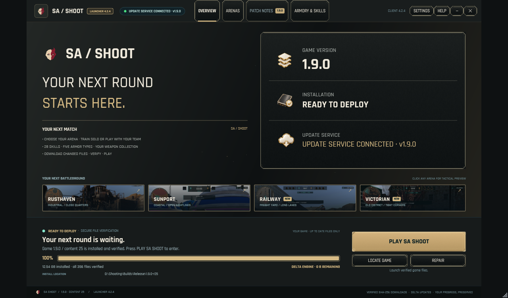

<picture>
  <source media="(prefers-reduced-motion: reduce)" srcset="https://raw.githubusercontent.com/salah-del/sa-shoot-releases/main/assets/hero-184.png">
  
</picture>

   
  <strong>YOUR SQUAD. YOUR ROUND.</strong> 
  A tactical arena shooter. Choose your abilities. Outplay the opposing team. Survive the closing zone.

  

   
  <strong>4.2.4 COMPATIBILITY PREVIEW</strong> · ZIP, 78.0 MB · Extract the entire folder before opening. 
  Game 1.9.0 · Windows x64 · Internet and a registered account required  
  <a href="https://github.com/salah-del/sa-shoot-releases/releases/download/launcher-v4.2.3/SA-SHOOT-Setup.exe">Standard launcher 4.2.3 · EXE, 79.1 MB</a> &nbsp; / &nbsp;
  <a href="https://github.com/salah-del/sa-shoot-releases/releases/tag/launcher-v4.2.4-compatibility">4.2.4 release notes</a>  
  <a href="#the-arena">GAMEPLAY</a> &nbsp; / &nbsp;
  <a href="#your-squad">THE LOBBY</a> &nbsp; / &nbsp;
  <a href="#pc-requirements">PC REQUIREMENTS</a> &nbsp; / &nbsp;
  <a href="#play-in-three-steps">INSTALL</a> &nbsp; / &nbsp;
  <a href="#new-in-190">WHAT'S NEW</a> &nbsp; / &nbsp;
  <a href="#العربية">العربية</a>

---

| CHOOSE YOUR FIGHT | BUILD YOUR PLAY | FINISH THE ROUND |
| :---: | :---: | :---: |
| **1v1 · 2v2 · 3v3** | **28 tactical abilities** | **8 rounds + a tiebreak** |
| Queue solo or bring your party. | Recon, smoke, mobility and more. | Eliminate the other team. Watch the zone. |

## PC requirements

**Choose your starting profile. Tune it to your PC.**

> **Public-test guidance:** the Low / Medium / High configurations below are **provisional test targets**, not certified minimum requirements or measured FPS promises. Those CPU/GPU combinations have not all been tested with SA SHOOT. Use them to choose an initial setting on a PC you already own; do not base a hardware purchase on this table alone.

| COMPONENT | LOW · LIGHTER SETTINGS | MEDIUM · BALANCED | HIGH · MORE DETAIL |
| :--- | :--- | :--- | :--- |
| **CPU — suggested** | Intel Core i5-8400 / AMD Ryzen 5 2600 | Intel Core i5-10400 / AMD Ryzen 5 3600 | Intel Core i5-12400 / AMD Ryzen 5 5600 |
| **GPU — suggested** | NVIDIA GTX 1650 4 GB / AMD RX 570 4 GB | NVIDIA RTX 2060 6 GB / AMD RX 6600 8 GB | NVIDIA RTX 4060 8 GB / AMD RX 6700 XT 12 GB |
| **RAM — suggested** | 16 GB | 16 GB | 32 GB |
| **Starting resolution** | 1280 × 720 | 1920 × 1080 | 1920 × 1080 |
| **In-game quality preset** | Low | Medium | HD; try Ultra after checking frame time |
| **Storage headroom** | SSD · 40 GB free recommended | SSD · 40 GB free recommended | SSD · 40 GB free recommended |

**Platform & installation:** Windows x64 only. Windows 11 is the locally tested platform; Windows 10 startup compatibility is still being verified. The current game uses DirectX 11. A keyboard, mouse, internet connection and registered account are needed. No separate .NET download is needed for the bundled launcher. Windows 32-bit, macOS, Linux and ARM-native builds are not provided.

**Download size is not installed size.** A fresh 1.9.0 installation downloads about **6.92 GB** and occupies about **12.54 GB**. Keep extra space for download cache, staging and safe update recovery; the launcher checks the space required for your actual installation. Existing players download only changed, missing or damaged files. These sizes will change with future releases.

**Your FPS stays real.** You can select an uncapped frame-rate option; that removes the software limit, but does not guarantee 60, 144 or 240 FPS. Map density, CPU, GPU, resolution, cooling and graphics settings determine actual performance. Start lower in Final Ground, especially DarkForest.

<strong>Measured performance — what has actually been checked</strong>

The existing 90-second standalone checks used an **RTX 4050 Laptop GPU**, **1280 × 800**, **Ultra**, VSync off and no FPS cap, with **47 bots plus the local player**. Average results: **Sherwood 67.3 FPS**, **DarkForest 40.0 FPS**. DarkForest still showed occasional long frames. These were fixed-view test runs, not a full hardware certification or a guarantee for a moving player, every map or every PC. They are not 1080p results.

CPU/GPU combinations in the suggested table remain unvalidated. A certified minimum specification will require testing those machines. Laptop and desktop GPUs with similar names can perform differently.

## The arena

**Information wins fights. Movement keeps you alive.**

<table>
  <tr>
    <td width="50%"></td>
    <td width="50%"></td>
  </tr>
  <tr>
    <td><strong>01 / RUSTHAVEN</strong> Industrial cover. Tight angles. Close encounters.</td>
    <td><strong>02 / SUNPORT</strong> Coastal structures. Open sightlines. Crossing routes.</td>
  </tr>
  <tr>
    <td><strong>03 / RAILWAY</strong> Freight yards, containers and elevated sightlines.</td>
    <td><strong>04 / VICTORIAN</strong> Brick streets, narrow corners and flanking paths.</td>
  </tr>
</table>

Actual gameplay captures from an earlier public test. The current version includes further interface updates.

## Your squad

**Meet in the lobby. Choose a mode. Enter together.**

Lobby preview from an earlier public test, with an example party. The current interface may differ.

| TEAM PLAY | PRACTICE | MAKE IT YOURS |
| :--- | :--- | :--- |
| Bring friends into your party and use team voice controls. | Train against bots or configure a Custom session. | Adjust HUD placement, text sizes, controls and weapon-wheel preferences. |
| Use recon and team pings to share information. | Explore the Competitive arenas, or play Final Ground with your squad. | Keep your account and settings between updates. |

## Play in three steps

**A single launcher. Your existing installation stays with you.**

Actual 4.2.4 compatibility-preview capture · Game 1.9.0 · 356 files verified.

| | FIRST TIME HERE | ALREADY HAVE THE GAME |
| :---: | :--- | :--- |
| **01** | Download the **4.2.4 ZIP**, choose **Extract All**, then open **SA-SHOOT-Setup.exe** inside the extracted folder. | Extract the new launcher ZIP to its own folder, open it, then choose **LOCATE GAME**. |
| **02** | Choose your game folder and press **DOWNLOAD**. Keep all launcher files together. | Select the folder containing **SA SHOOT.exe** and **SA SHOOT_Data**. |
| **03** | Wait for verification, press **PLAY**, then sign in. | Press **UPDATE GAME** if offered, wait for verification, then **PLAY**. |

The **standard 4.2.3 EXE** is also available above. The **4.2.4 ZIP is the newest published launcher**, offered as a compatibility preview; automatic launcher updates currently remain on 4.2.3. Do not copy the preview EXE out of its folder or run it inside the ZIP.

> **Keep what you downloaded.** Updates reuse verified unchanged files and download only the changed or damaged files your installation needs. If a transfer stops, reopen the launcher to resume.

## New in 1.9.0

| FINAL GROUND | PRIVATE PRACTICE | CLEARER INFORMATION |
| :--- | :--- | :--- |
| Join your squad in a 48-seat match on Sherwood or DarkForest. | Share hit-zone and shot-path training overlays with your friend. | Navigate the full map with zoom, pan, supply markers and team waypoints. |
| Reconnect to your match; results and XP are recorded once. | Host-controlled settings, death reports and practice respawns stay in sync. | Improved report layout, loading feedback and responsive interface sizing. |

**Update together.** This version uses a new match protocol. Everyone in a party must update before joining a new match together.

**Launcher 4.2.4 compatibility preview** adds startup diagnostics, an optional software-rendered launcher mode and recovery from a file lock during a launcher update. It includes its runtime as ordinary files. Game files and account data stay separate; the automatic launcher channel remains on **4.2.3** pending affected-device testing.

> **Public test:** performance is still being improved, especially in dense DarkForest areas. Frame rate depends on your hardware and settings. Online tests used separate accounts and real network clients on one PC; independent-device testing remains outstanding. Final Ground uses host-authoritative gameplay with server-validated rewards; it does not use a dedicated authoritative game server.

<strong>Coming soon — features temporarily locked</strong>

Private spectators, Replay/timeline and Rematch remain temporarily unavailable.

<strong>Installation & update help</strong>

- **PLAY is unavailable:** finish the download and file verification first.
- **The game is already installed:** use **LOCATE GAME** and select its main folder, not the executable alone.
- **A download was interrupted:** reopen the launcher; verified progress is reused.
- **A file is missing or damaged:** choose **REPAIR**.
- **An older launcher cannot update:** download the current launcher above, extract it completely, and locate your existing game folder.
- **The launcher does not appear:** in the 4.2.4 extracted folder, try **Start in compatibility mode.cmd**. This changes launcher rendering only, not game graphics.
- **It still cannot start:** use **Collect startup report.cmd**. Review the local **Support** folder before sharing it; reports may contain your Windows username and paths. Nothing is sent automatically.
- **Windows reports a blocked or unknown publisher:** the current launcher is unsigned. Keep the exact warning for support; do not disable Defender or add exclusions. Windows 10 on the originally affected machine has not yet been verified.

Platform references: [Unity Windows requirements](https://docs.unity.com/en-us/engine/6000.6/manual/platform-specific/windows/requirements-and-compatibility) and [Microsoft runtime support](https://learn.microsoft.com/en-us/dotnet/core/install/windows). These describe the underlying software, not SA SHOOT performance certification.

[Read the release notes →](https://github.com/salah-del/sa-shoot-releases/releases/tag/v1.9.0)

---

## العربية

**فريقك. جولتك. قرارك.**

لعبة تصويب تكتيكية بمودات **1 ضد 1، و2 ضد 2، و3 ضد 3**. اختار من **28 مهارة**، العب مع أصحابك، واكسب المواجهة قبل ما الزون تقفل. الماتش **8 راوندات**، ومع التعادل **4–4** فيه راوند فاصل.

**اللعبة 1.9.0 · أحدث لانشر منشور 4.2.4 — نسخة تجربة توافق · نسخة اللعبة اختبار عامة**

1. نزّل أحدث لانشر من زر **Download for Windows**، وفك ملف الـZIP كاملًا باختيار **Extract All**. افتح **SA-SHOOT-Setup.exe** من الفولدر بعد فكّه، وسيب كل ملفاته مع بعض.
2. أول مرة؟ اختار فولدر واضغط **DOWNLOAD**.
3. اللعبة موجودة عندك؟ اختار **LOCATE GAME** وحدد الفولدر اللي فيه **SA SHOOT.exe** و**SA SHOOT_Data**.
4. بعد اكتمال التنزيل وفحص الملفات، اضغط **PLAY** وسجّل دخولك.

**مش محتاج تنزّل اللعبة من الأول.** اللانشر بيحتفظ بالملفات السليمة، وبينزّل المتغيّر أو التالف فقط. ولو التنزيل وقف، تقدر تكمّله.

التحديث يفتح أونلاين **Final Ground** مع أصحابك، مع مزامنة النتيجة وتسجيل الـXP مرة واحدة. الكاستم الخاص يشارك حدود الإصابة ومسار الطلقات بين اللاعبين. الخريطة الكبيرة فيها تكبير وتحريك ومواقع الإمدادات وعلامات الفريق، مع تحسين تقرير الموت والتحميل والواجهات.

**حدّثوا كلكم قبل دخول الـParty للمباراة.** زر التنزيل يجيب **4.2.4 كتجربة توافق**، والتحديث التلقائي للانشر لسه على **4.2.3**. الاتنين بيقرؤوا تحديث اللعبة **1.9.0**؛ اللعبة الموجودة عندك بتنزل الملفات المتغيّرة أو الناقصة أو التالفة فقط.

**مواصفات Low / Medium / High موجودة في الجدول فوق كاقتراحات مبدئية، مش حد أدنى معتمد أو ضمان فريمات.** الجودة العالية اسمها **HD** جوه الإعدادات، وفيه **Ultra** أعلى منها. اختبارات الأجهزة الضعيفة والمتوسطة لسه ناقصة. ننصح بمساحة فاضية **40 جيجابايت على SSD** للتنزيل والتحديث؛ حجم اللعبة بعد التثبيت حوالي **12.54 جيجابايت**.

**لو اللانشر مش بيفتح:** بعد فك الـZIP كاملًا، جرّب **Start in compatibility mode.cmd**. نسخة 4.2.4 اتجرّبت محليًا على Windows 11؛ جهاز Windows 10 اللي ظهرت عنده المشكلة لسه محتاج تجربة. اللانشر غير موقّع حاليًا، وما تطفيش Defender لو ظهر تحذير.

**المتفرّج الخاص والـReplay والـRematch لسه مقفولين.** تحسين الأداء مستمر، خصوصًا في المناطق الكثيفة. اختبار الأونلاين اتعمل بحسابين وعميلين فعليين على نفس الجهاز؛ اختبار أجهزة وشبكات مستقلة لسه مطلوب. استضافة اللعب حاليًا عند الـHost، والنتيجة والمكافآت بيتراجعوا في الخدمة؛ مفيش سيرفر لعب مستقل موثوق بالكامل.

---

  <strong>READY FOR YOUR NEXT ROUND?</strong>  
    
  SA / SHOOT — THE WRAITH PROTOCOL · Page updated 3 November 2026

