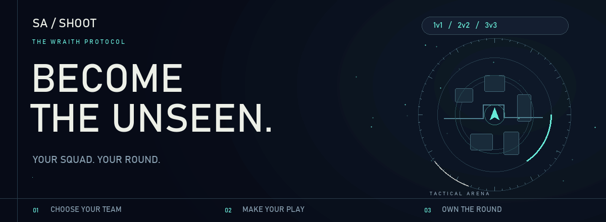
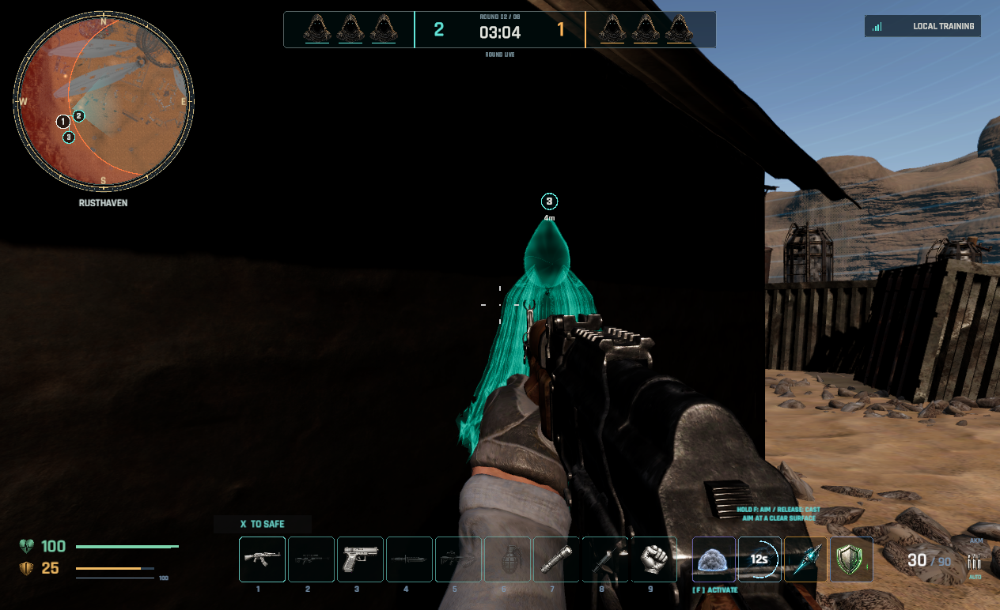
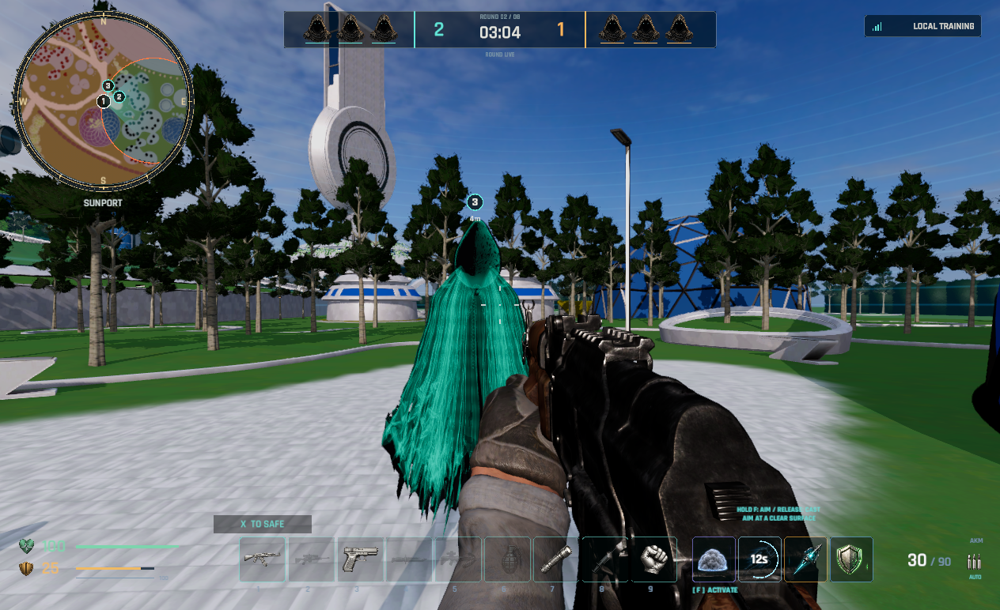
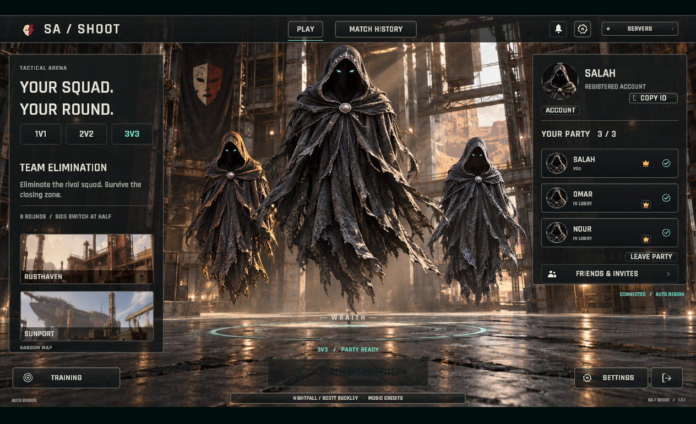
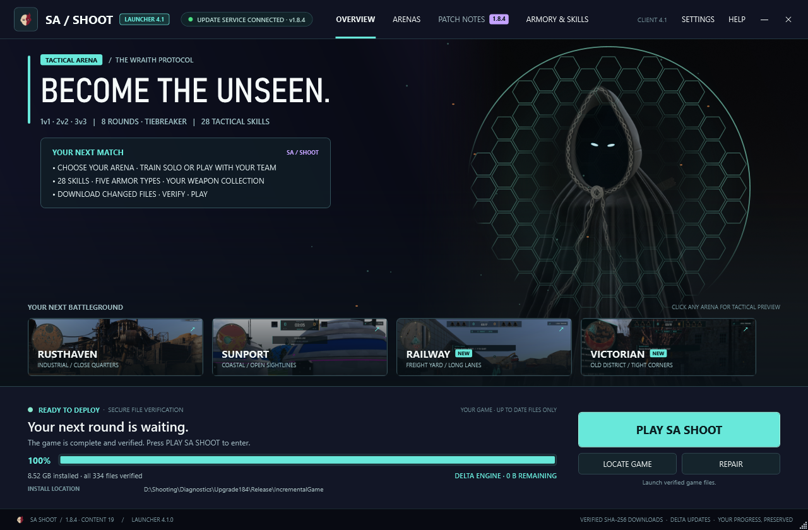

<picture>
  <source media="(prefers-reduced-motion: reduce)" srcset="assets/hero-184.png">
  
</picture>

   
  <strong>YOUR SQUAD. YOUR ROUND.</strong> 
  A tactical arena shooter. Choose your abilities. Outplay the opposing team. Survive the closing zone.

  

   
  Windows 64-bit · Internet connection and a registered account required  
  <a href="#the-arena">GAMEPLAY</a> &nbsp; / &nbsp;
  <a href="#your-squad">THE LOBBY</a> &nbsp; / &nbsp;
  <a href="#play-in-three-steps">INSTALL</a> &nbsp; / &nbsp;
  <a href="#new-in-184">WHAT'S NEW</a> &nbsp; / &nbsp;
  <a href="#العربية">العربية</a>

---

| CHOOSE YOUR FIGHT | BUILD YOUR PLAY | FINISH THE ROUND |
| :---: | :---: | :---: |
| **1v1 · 2v2 · 3v3** | **28 tactical abilities** | **8 rounds + a tiebreak** |
| Queue solo or bring your party. | Recon, smoke, mobility and more. | Eliminate the other team. Watch the zone. |

## The arena

**Information wins fights. Movement keeps you alive.**

<table>
  <tr>
    <td width="50%"></td>
    <td width="50%"></td>
  </tr>
  <tr>
    <td><strong>01 / RUSTHAVEN</strong> Industrial cover. Tight angles. Close encounters.</td>
    <td><strong>02 / SUNPORT</strong> Coastal structures. Open sightlines. Crossing routes.</td>
  </tr>
  <tr>
    <td><strong>03 / RAILWAY</strong> Freight yards, containers and elevated sightlines.</td>
    <td><strong>04 / VICTORIAN</strong> Brick streets, narrow corners and flanking paths.</td>
  </tr>
</table>

Actual gameplay captures from an earlier public test. The current version includes further interface updates.

## Your squad

**Meet in the lobby. Choose a mode. Enter together.**

In-game lobby preview with an example party.

| TEAM PLAY | PRACTICE | MAKE IT YOURS |
| :--- | :--- | :--- |
| Bring friends into your party and use team voice controls. | Train against bots or configure a Custom session. | Adjust HUD placement, text sizes, controls and weapon-wheel preferences. |
| Use recon and team pings to share information. | Explore four arenas and learn your ability timings. | Keep your account and settings between updates. |

## Play in three steps

**A single launcher. Your existing installation stays with you.**

Actual Launcher 4.1 · Game 1.8.4 verified and ready to play.

| | FIRST TIME HERE | ALREADY HAVE THE GAME |
| :---: | :--- | :--- |
| **01** | Download and open **SA-SHOOT-Setup.exe**. | Open the launcher and choose **LOCATE GAME**. |
| **02** | Choose an installation folder and press **DOWNLOAD**. | Select the folder containing **SA SHOOT.exe** and **SA SHOOT_Data**. |
| **03** | Wait for verification, press **PLAY**, then sign in. | Press **UPDATE GAME** if offered, then **PLAY**. |

> **Keep what you downloaded.** Updates reuse verified unchanged files and download only the changed or damaged files your installation needs. If a transfer stops, reopen the launcher to resume.

## New in 1.8.4

| IN THE MATCH | IN YOUR HANDS | BETWEEN MATCHES |
| :--- | :--- | :--- |
| Interrupted-connection recovery that preserves match resources. | Clearer active-skill feedback and grenade/Molotov selection. | Private matches and cooperative practice. |
| Team pings, voice controls and AFK takeover. | Adjustable HUD text, weapon-wheel order and proportioned icons. | More training controls and optional local gameplay highlights. |

**Launcher 4.1** introduces a refreshed navy, cyan and violet interface, clear update-service status, current-version patch notes and automatic launcher updates.

<strong>Coming soon — features temporarily locked</strong>

Private spectators, Replay/timeline and Rematch remain visible with a lock and **Coming soon**. Ordinary online matches and the teammate view after death remain available.

<strong>Installation & update help</strong>

- **PLAY is unavailable:** finish the download and file verification first.
- **The game is already installed:** use **LOCATE GAME** and select its main folder, not the executable alone.
- **A download was interrupted:** reopen the launcher; verified progress is reused.
- **A file is missing or damaged:** choose **REPAIR**.
- **An older launcher cannot update:** download the current launcher above and locate your existing game folder.

[Read the release notes →](https://github.com/salah-del/sa-shoot-releases/releases/tag/v1.8.4)

---

## العربية

**فريقك. جولتك. قرارك.**

لعبة تصويب تكتيكية بمودات **1 ضد 1، و2 ضد 2، و3 ضد 3**. اختار من **28 مهارة**، العب مع أصحابك، واكسب المواجهة قبل ما الزون تقفل. الماتش **8 راوندات**، ومع التعادل **4–4** فيه راوند فاصل.

**اللعبة 1.8.4 · اللانشر 4.1 · نسخة اختبار عامة**

1. نزّل اللانشر من زر **Download for Windows**.
2. أول مرة؟ اختار فولدر واضغط **DOWNLOAD**.
3. اللعبة موجودة عندك؟ اختار **LOCATE GAME** وحدد الفولدر اللي فيه **SA SHOOT.exe** و**SA SHOOT_Data**.
4. بعد اكتمال التنزيل وفحص الملفات، اضغط **PLAY** وسجّل دخولك.

**مش محتاج تنزّل اللعبة من الأول.** اللانشر بيحتفظ بالملفات السليمة، وبينزّل المتغيّر أو التالف فقط. ولو التنزيل وقف، تقدر تكمّله.

التحديث يشمل تحسينات التحكم وواجهة اللعب واستعادة الاتصال، مع لانشر بشكل جديد. **المتفرّج الخاص والـReplay والـRematch مقفولين مؤقتًا بعلامة Coming soon.**

---

  <strong>READY FOR YOUR NEXT ROUND?</strong>  
    
  SA / SHOOT — THE WRAITH PROTOCOL

