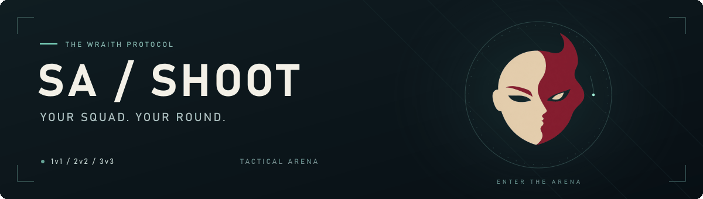
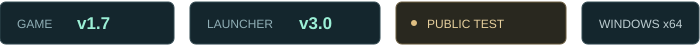
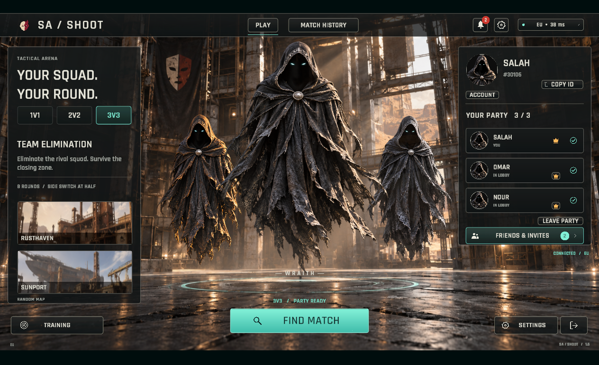
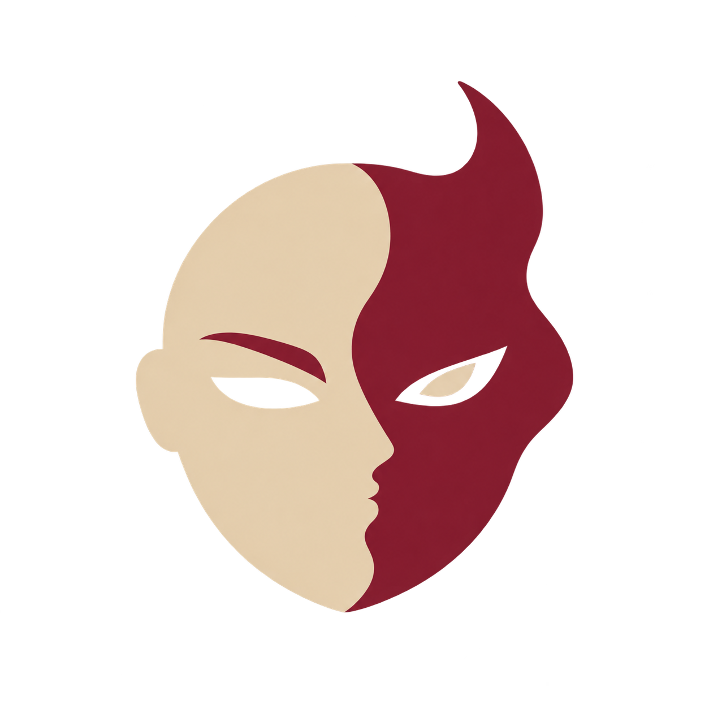

<picture>
  <source media="(prefers-reduced-motion: reduce)" srcset="assets/banner.png">
  
</picture>

  

  
   
  <a href="https://github.com/salah-del/sa-shoot-releases/releases/download/v1.6/SA-SHOOT-Setup.exe">Download launcher</a>
  &nbsp; · &nbsp;
  <a href="https://github.com/salah-del/sa-shoot-releases/releases/tag/v1.7.1">What's new in v1.7.1</a>
  &nbsp; · &nbsp;
  <a href="#start-playing">Installation guide</a>
  &nbsp; · &nbsp;
  <a href="#العربية">العربية</a>

<strong>Game v1.7.1 · Launcher v3.0</strong> Windows 64-bit · Internet connection and a SA SHOOT account required.

> **Already using Launcher 2.0?** Open the new launcher once and choose **LOCATE GAME**. Keep your installed game. Future launcher updates appear inside the launcher.

## Start playing

| 🖥️ First time here? | 📂 Already have the game? |
| :--- | :--- |
| **1.** Open **SA-SHOOT-Setup.exe**. | **1.** Open the new launcher and choose **LOCATE GAME**. |
| **2.** Select your folder and press **DOWNLOAD**. | **2.** Select the folder containing **SA SHOOT.exe** and **SA SHOOT_Data**. |
| **3.** When installation finishes, press **PLAY**. | **3.** Press **UPDATE GAME**, then **PLAY** when it's ready. |

**Updating from game 1.7?** The 1.7.1 update downloads about **325 MB**. Your unchanged game files stay in place. A new installation needs the complete game; the launcher shows the required download size.

## Your next lobby

Version 1.6 lobby preview · Example party shown.

### What's new in 1.7.1

- **Bigger elimination messages:** clearer names, weapon artwork and head/body/leg icons.
- **Weapon artwork fits correctly:** removed transparent padding that made horizontal weapons too small.
- **Larger bottom slots:** equipment, ability icons and cooldown counters are easier to read.
- **Keep your installation:** 279 unchanged runtime files are reused; only five changed files download.

## Quick help

<strong>Which files do I need to download?</strong>

Just **SA-SHOOT-Setup.exe**, using the button above. The launcher handles the game files. You do not need the `.partNN` files or GitHub's “Source code” downloads.

<strong>How do updates and interrupted downloads work?</strong>

Use **UPDATE GAME** when prompted. Only changed, missing or damaged files download; the rest are reused. If your connection drops, use **RESUME** or **RETRY**. **PLAY** unlocks after the required files are verified.

The launcher keeps your game folder when it updates itself. Updates do not replace game files during an active match. Your account and settings are kept separately.

<strong>The game needs repair, or Windows shows an unfamiliar publisher.</strong>

For missing or damaged files, open launcher **SETTINGS → VERIFY / REPAIR GAME FILES**.

This public-test launcher is not code-signed yet, so Windows may show an unknown-publisher notice. Use the download link on this page. No changes to Windows security settings are required.

<strong>Public-test status and known issues</strong>

SA SHOOT 1.7.1 is an **early public test**. Some players may still encounter connection issues. See the [release notes](https://github.com/salah-del/sa-shoot-releases/releases/tag/v1.7.1) for known limitations and update details.

## العربية

<strong>🇪🇬 التحميل والتثبيت والتحديث</strong>

الإصدار الحالي للعبة **1.7.1**، وإصدار اللانشر **3.0**.

1. نزّل اللانشر من زر **Download** الموجود فوق وافتحه.
2. لو أول مرة تثبّت اللعبة، اختار المسار واضغط **DOWNLOAD**.
3. لو اللعبة موجودة عندك، اضغط **LOCATE GAME** واختار الفولدر اللي فيه **SA SHOOT.exe** و**SA SHOOT_Data**، وبعدها **UPDATE GAME**.
4. بعد اكتمال التنزيل وفحص الملفات، اضغط **PLAY**.

التحديث من **1.7** إلى **1.7.1** حوالي **325 ميجابايت**؛ مش محتاج تنزّل اللعبة كاملة من جديد.

لو عندك اللانشر القديم **2.0**، افتح الجديد مرة واحدة بس واختار لعبتك الموجودة. بعد كده تحديثات اللانشر نفسه هتظهر جواه. **ما تمسحش اللعبة**، ومش محتاج تنزّل ملفات الأجزاء بنفسك.

اللعبة حاليًا نسخة اختبار عام، ومحتاجة إنترنت وحساب SA SHOOT.

---

 <strong>SA / SHOOT</strong> Your squad. Your round.

