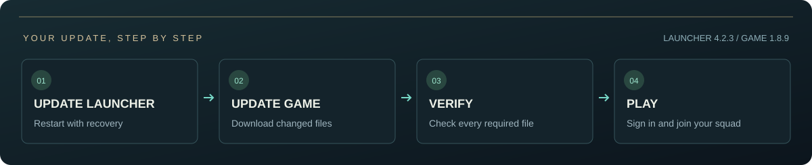

<picture>
  <source media="(prefers-reduced-motion: reduce)" srcset="assets/hero-184.png">
  
</picture>

   
  <strong>YOUR SQUAD. YOUR ROUND.</strong> 
  A tactical arena shooter. Choose your abilities. Outplay the opposing team. Survive the closing zone.

  

   
  Windows 64-bit · Internet connection and a registered account required  
  <a href="#the-arena">GAMEPLAY</a> &nbsp; / &nbsp;
  <a href="#your-squad">THE LOBBY</a> &nbsp; / &nbsp;
  <a href="#play-in-three-steps">INSTALL</a> &nbsp; / &nbsp;
  <a href="#new-in-190">WHAT'S NEW</a> &nbsp; / &nbsp;
  <a href="#العربية">العربية</a>

---

| CHOOSE YOUR FIGHT | BUILD YOUR PLAY | FINISH THE ROUND |
| :---: | :---: | :---: |
| **1v1 · 2v2 · 3v3** | **28 tactical abilities** | **8 rounds + a tiebreak** |
| Queue solo or bring your party. | Recon, smoke, mobility and more. | Eliminate the other team. Watch the zone. |

## The arena

**Information wins fights. Movement keeps you alive.**

<table>
  <tr>
    <td width="50%"></td>
    <td width="50%"></td>
  </tr>
  <tr>
    <td><strong>01 / RUSTHAVEN</strong> Industrial cover. Tight angles. Close encounters.</td>
    <td><strong>02 / SUNPORT</strong> Coastal structures. Open sightlines. Crossing routes.</td>
  </tr>
  <tr>
    <td><strong>03 / RAILWAY</strong> Freight yards, containers and elevated sightlines.</td>
    <td><strong>04 / VICTORIAN</strong> Brick streets, narrow corners and flanking paths.</td>
  </tr>
</table>

Actual gameplay captures from an earlier public test. The current version includes further interface updates.

## Your squad

**Meet in the lobby. Choose a mode. Enter together.**

Lobby preview from an earlier public test, with an example party. The current interface may differ.

| TEAM PLAY | PRACTICE | MAKE IT YOURS |
| :--- | :--- | :--- |
| Bring friends into your party and use team voice controls. | Train against bots or configure a Custom session. | Adjust HUD placement, text sizes, controls and weapon-wheel preferences. |
| Use recon and team pings to share information. | Explore the Competitive arenas, or play Final Ground with your squad. | Keep your account and settings between updates. |

## Play in three steps

**A single launcher. Your existing installation stays with you.**

Update flow for Launcher 4.2.3 and Game 1.9.0. PLAY unlocks after file verification.

| | FIRST TIME HERE | ALREADY HAVE THE GAME |
| :---: | :--- | :--- |
| **01** | Download and open **SA-SHOOT-Setup.exe**. | Open the launcher and choose **LOCATE GAME**. |
| **02** | Choose an installation folder and press **DOWNLOAD**. | Select the folder containing **SA SHOOT.exe** and **SA SHOOT_Data**. |
| **03** | Wait for verification, press **PLAY**, then sign in. | Press **UPDATE GAME** if offered, then **PLAY**. |

> **Keep what you downloaded.** Updates reuse verified unchanged files and download only the changed or damaged files your installation needs. If a transfer stops, reopen the launcher to resume.

## New in 1.9.0

| FINAL GROUND | PRIVATE PRACTICE | CLEARER INFORMATION |
| :--- | :--- | :--- |
| Join your squad in a 48-seat match on Sherwood or DarkForest. | Share hit-zone and shot-path training overlays with your friend. | Navigate the full map with zoom, pan, supply markers and team waypoints. |
| Reconnect to your match; results and XP are recorded once. | Host-controlled settings, death reports and practice respawns stay in sync. | Improved report layout, loading feedback and responsive interface sizing. |

**Update together.** This version uses a new match protocol. Everyone in a party must update before joining a new match together.

**Launcher 4.2.3** remains the current launcher. It verifies installed files, downloads changed or damaged files, and preserves your account and settings.

> **Public test:** performance is still being improved, especially in dense DarkForest areas. Frame rate depends on your hardware and settings. Online tests used separate accounts and real network clients on one PC; independent-device testing remains outstanding. Final Ground uses host-authoritative gameplay with server-validated rewards; it does not use a dedicated authoritative game server.

<strong>Coming soon — features temporarily locked</strong>

Private spectators, Replay/timeline and Rematch remain temporarily unavailable.

<strong>Installation & update help</strong>

- **PLAY is unavailable:** finish the download and file verification first.
- **The game is already installed:** use **LOCATE GAME** and select its main folder, not the executable alone.
- **A download was interrupted:** reopen the launcher; verified progress is reused.
- **A file is missing or damaged:** choose **REPAIR**.
- **An older launcher cannot update:** download the current launcher above and locate your existing game folder.

[Read the release notes →](https://github.com/salah-del/sa-shoot-releases/releases/tag/v1.9.0)

---

## العربية

**فريقك. جولتك. قرارك.**

لعبة تصويب تكتيكية بمودات **1 ضد 1، و2 ضد 2، و3 ضد 3**. اختار من **28 مهارة**، العب مع أصحابك، واكسب المواجهة قبل ما الزون تقفل. الماتش **8 راوندات**، ومع التعادل **4–4** فيه راوند فاصل.

**اللعبة 1.9.0 · اللانشر 4.2.3 · نسخة اختبار عامة**

1. نزّل اللانشر من زر **Download for Windows**.
2. أول مرة؟ اختار فولدر واضغط **DOWNLOAD**.
3. اللعبة موجودة عندك؟ اختار **LOCATE GAME** وحدد الفولدر اللي فيه **SA SHOOT.exe** و**SA SHOOT_Data**.
4. بعد اكتمال التنزيل وفحص الملفات، اضغط **PLAY** وسجّل دخولك.

**مش محتاج تنزّل اللعبة من الأول.** اللانشر بيحتفظ بالملفات السليمة، وبينزّل المتغيّر أو التالف فقط. ولو التنزيل وقف، تقدر تكمّله.

التحديث يفتح أونلاين **Final Ground** مع أصحابك، مع مزامنة النتيجة وتسجيل الـXP مرة واحدة. الكاستم الخاص يشارك حدود الإصابة ومسار الطلقات بين اللاعبين. الخريطة الكبيرة فيها تكبير وتحريك ومواقع الإمدادات وعلامات الفريق، مع تحسين تقرير الموت والتحميل والواجهات.

**حدّثوا كلكم قبل دخول الـParty للمباراة.** اللانشر الحالي **4.2.3** ينزّل الملفات المتغيّرة أو التالفة فقط؛ مش مطلوب تنزيل اللعبة كاملة.

**المتفرّج الخاص والـReplay والـRematch لسه مقفولين.** تحسين الأداء مستمر، خصوصًا في المناطق الكثيفة. اختبار الأونلاين اتعمل بحسابين وعميلين فعليين على نفس الجهاز؛ اختبار أجهزة وشبكات مستقلة لسه مطلوب. استضافة اللعب حاليًا عند الـHost، والنتيجة والمكافآت بيتراجعوا في الخدمة؛ مفيش سيرفر لعب مستقل موثوق بالكامل.

---

  <strong>READY FOR YOUR NEXT ROUND?</strong>  
    
  SA / SHOOT — THE WRAITH PROTOCOL

